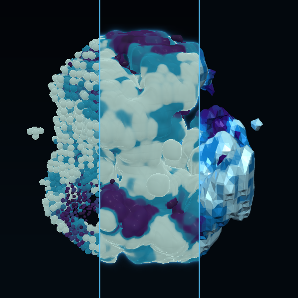

# Abissal

**Autor:** Murilo Jorge de Figueiredo

## O que é

Um organismo mole e luminoso que cresce, se dobra, abre túneis e se apaga por
dentro. Só que ele não existe: é um **jogo da vida discreto**, numa grade de
40 × 40 × 40 células, e toda a continuidade vem de **um parâmetro do ray
marching**. O botão **ver as células** zera esse parâmetro e mostra o que estava
por trás: contas separadas que nascem e morrem em saltos, geração a geração. A
troca é animada, e dá para ver o organismo se desfazer em células e se refazer.

Um terceiro botão, **ver a malha**, congela um instante e transforma o
organismo num objeto de verdade, feito de triângulos: uma `p5.Geometry` que o
p5 desenha como qualquer malha e que pode ser salva em **.stl** e impressa. São
três maneiras de ver a mesma coisa: o que ela **é** (células), como o raio a
**desenha** (o organismo) e como ela pode ser **construída** (a malha).

No thumbnail, da esquerda para a direita: as células, o organismo e a malha, no
mesmo instante.

## A regra

Cada célula olha as 26 vizinhas do cubo em volta dela:

- uma célula vazia **nasce** se tem 6, 7 ou 8 vizinhas vivas;
- uma viva **sobrevive** com 4 a 7 vizinhas;
- senão ela não some de uma vez: passa por 8 estados de **esfriamento**, em que
  não conta como vizinha, e só então vira vazio.

É a regra de vida 3D conhecida como *Pyroclastic* (S4-7/B6-8/10). A partir de
uma semente cresce um corpo que nunca para de se refazer por dentro. Fora de
uma esfera no meio da grade nada vive, então o organismo fica solto no escuro.

## O organismo é o ray marching

Cada célula é uma **esfera crua**, do tamanho da sua densidade: 1 viva, menos
enquanto esfria, 0 vazia. O valor anda suavemente entre as gerações, e a célula
incha ao nascer e murcha ao morrer. A grade vai para a placa de vídeo como uma
**textura**, com as 40 fatias lado a lado.

Para cada pixel, o raio entra no cubo e, a cada passo, consulta as 27 células
em volta do ponto e calcula a distância até a forma. A forma é a **união suave**
(*smooth min*) das esferas, com raio **k**:

- **k = 0** é a união comum: contas separadas, a grade à mostra. É o jogo da
  vida como ele é, discreto, em saltos;
- **k grande**: a distância "cede" entre esferas vizinhas e elas se fundem numa
  massa mole, com pontes e gargalos. É o organismo.

Nada é borrado nem pré-calculado: é o mesmo dado, com um parâmetro do ray
marching mudado. O controle **fusão (k)** mexe nele diretamente, e o botão o
anima de zero até o valor escolhido.

A normal vem do gradiente da distância, e a cor é misturada entre as células com
o mesmo peso da união. Em volta da superfície, o raio soma o calor que atravessa
de raspão: o brilho.

**Pulo do espaço vazio.** Consultar 27 células a cada passo é caro. Por isso a
textura guarda, para cada célula, se há alguma vizinha viva. Onde não há, o raio
pula uma célula inteira sem consultar nenhuma.

## A malha

A aula de modelagem 3D entra aqui. A mesma distância da união suave é
calculada em JavaScript, igual à do shader, numa grade de amostras, e
convertida numa `p5.Geometry` construída na mão:

- **vértices**: cada cubinho da grade de amostras é cortado em 6 tetraedros
  (*marching tetrahedra*, o primo sem tabelas do *marching cubes*). Em cada
  aresta onde a distância troca de sinal nasce um vértice, no ponto
  interpolado;
- **faces**: trios de índices, ordenados em sentido **anti-horário** vistos de
  fora, para a normal apontar para fora do organismo (o lado de fora é
  descoberto pelos cantos do tetraedro que ficam fora da forma);
- **normais**: cada triângulo tem seus três vértices próprios, e
  `computeNormals()` (`FLAT`) dá uma normal por face, então a malha aparece
  facetada, com cada triângulo à mostra. Esse é o ponto: ver a superfície como
  objeto construído;
- **cor por vértice** (`vertexColors`), da mesma paleta do shader;
- `model()` desenha, `freeGeometry()` libera a malha anterior quando ela é
  refeita, e **salvar .stl** usa `saveStl()`, com o dobro da resolução da tela.

Para não precisar alinhar duas câmeras diferentes, a malha é desenhada com
`perspective()` e `camera()` calculadas a partir da mesma câmera do raio. Por
isso as três visões têm exatamente o mesmo enquadramento. Montar dezenas de
milhares de triângulos leva algumas frações de segundo, então ver a malha
**congela** a vida: ela é um instante tirado do tempo.

## A cor

Cada célula tem uma "temperatura": a recém-nascida é a mais clara e, enquanto
morre, desce pela paleta até a cor mais escura. A paleta padrão, **abissal**,
vai do ciano pálido ao violeta escuro, como bioluminescência. O botão de cor
troca entre cinco paletas (abissal, brasa, orquídea, ouro e tinta, musgo).

## Testes

Antes de chegar aqui, comparamos o mesmo organismo, no mesmo instante, com
várias maneiras de o ray marching construir a superfície: campo borrado, união
suave curta e longa, células morrendo subtraídas, espaço espelhado, espaço
torcido, superfície ondulada, passo largo demais e poucos passos. A primeira
versão fundia as células borrando a grade antes de marchar. Trocamos para a
união suave porque assim a fusão vem do próprio ray marching, e o valor de k
foi escolhido comparando de 0 a 1,6. Também testamos uma grade de 28³ e uma de
40³; a maior deixa as dobras e a grade das células mais finas.

## Como usar

Abra o `index.html` no navegador.

| Controle | Ação |
|---|---|
| **ver as células / ver o organismo** (ou C) | anima k entre zero e o valor da fusão |
| **fusão (k)** | o raio da união suave |
| **ver a malha / ver o raio** (ou M) | congela um instante como `p5.Geometry` |
| **salvar .stl** | exporta o organismo para impressão 3D |
| **cor** | troca a paleta |
| **clique** | semeia vida no ponto apontado |
| **arrastar** / **roda do mouse** | girar / aproximar |
| **espaço** | pausa |
| **R** | recomeça |

O canvas usa o modo **WEBGL**. O organismo e as células são desenhados por um
shader próprio (`createShader`) num plano do tamanho da tela, com a grade
chegando ao shader como textura (`createImage`); a malha é uma `p5.Geometry`
desenhada com `model()`, luzes e `specularMaterial()`. O p5.js (versão 2.3.4) é carregado de CDN e não está no
zip.
