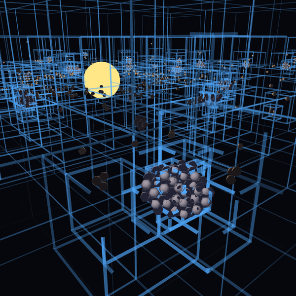

# Acreção

**Autor:** Murilo Jorge de Figueiredo

## O que é

Um disco de 1 500 grãos de poeira gira em volta de uma estrela. Os grãos se
atraem pela gravidade e, quando se tocam, se empilham. Nada no código fala em
montes ou planetas: em cerca de um minuto o disco se organiza sozinho em dezenas de
**montes de cascalho**, como os asteroides Bennu e Ryugu, e os montes se
juntam entre si.

## A gravidade e a octree

Cada grão atrai todos os outros: são mais de um milhão de pares por passo. Para
não calcular todos, o espaço é dividido numa **octree**, um cubo que se parte em
oito sempre que tem mais de um grão dentro. Cada nó guarda a massa total e o
centro de massa do que contém. Um grupo distante o bastante (lado do nó
dividido pela distância menor que θ = 0,9) atrai como se fosse um corpo só, no
seu centro de massa. É o algoritmo de **Barnes–Hut**: em vez de N² pares,
cerca de N·log N interações. A árvore fica guardada em arrays planos, sem criar
objetos.

## O perto e o longe

A gravidade dos grupos distantes muda devagar; a dos vizinhos, depressa. Por
isso a força é dividida em duas (*multiple time stepping*):

- o **longe** vem da octree e só é recalculado a cada 4 passos;
- o **perto** (grãos a menos de 10 unidades), a estrela e o contato são
  calculados a cada passo.

Os vizinhos de perto vêm de uma **grade de hash**: cada grão só olha as 27
células em volta da sua, com custo linear. Na hora de recalcular o longe, a
octree dá a força total, e a parte de perto, medida no mesmo instante, é
descontada.

Medimos: o passo da física caiu de 12–15 ms para 3,5–5 ms com 1 500 grãos. O
erro médio da força entre grãos, comparado à soma direta de todos os pares, é
de cerca de 4%, sem diferença visível no número e no tamanho dos montes.

## O contato

A mesma grade de perto encontra quem está encostando em quem. Grãos que se
tocam não se atravessam. Uma **mola** os separa e um **amortecedor** tira a
energia do choque. Quem bate devagar não tem mais energia para escapar da
gravidade do outro e fica.

O movimento é integrado com *leapfrog* (meio impulso, deslocamento, meio
impulso), que conserva a energia das órbitas por muito tempo.

O botão de modo troca o contato pela **fusão**: grãos que se tocam viram uma
esfera só, somando as massas e conservando o momento. A fusão é mais leve,
porque o número de corpos cai, mas o resultado são bolas lisas; empilhando, dá
para ver do que cada monte é feito.

## O 3D

- Modo **WEBGL**, com `orbitControl()` para girar e aproximar e `camera()` para
  a vista inicial.
- **Luzes:** a estrela é uma `sphere()` com `emissiveMaterial()` e uma
  `pointLight()` no centro, que ilumina o lado dos grãos voltado para ela; uma
  `ambientLight()` fraca clareia o lado escuro.
- **Os grãos** são desenhados por *instancing*: um único icosaedro
  (`p5.Geometry`) é desenhado centenas de vezes por chamada, com
  `model(pedra, quantidade)`. Um shader feito com
  `baseMaterialShader().modify()` move, escala e colore cada cópia, mantendo a
  luz e o `specularMaterial()` do p5. A cor muda conforme o tamanho do monte em
  que o grão está (os montes são calculados por união–busca sobre os pares em
  contato).
- **A octree** é desenhada com `box()` sem preenchimento: os nós que se
  dividiram, mais claros onde são mais fundos. A forma da árvore é um mapa da
  densidade e se aprofunda exatamente sobre cada monte.
- No modo fusão, os corpos grandes são `sphere()` com o detalhe da malha
  crescendo com o raio.

## Como usar

Abra o `index.html` no navegador.

| Controle | Ação |
|---|---|
| **arrastar** / **roda do mouse** | girar / aproximar |
| **recomeçar** (ou R) | novo disco aleatório |
| **pausar** (ou espaço) | congela a simulação |
| **esconder a octree** (ou O) | mostra só os grãos |
| **modo: empilhar / fundir** | troca o que acontece no contato |
| **grãos** | de 300 a 3 000 (recomeça ao soltar) |
| **velocidade** | passos de simulação por quadro |

O p5.js (versão 2.3.4) é carregado de CDN e não está no zip. O canvas usa
`windowWidth` e `windowHeight`.
