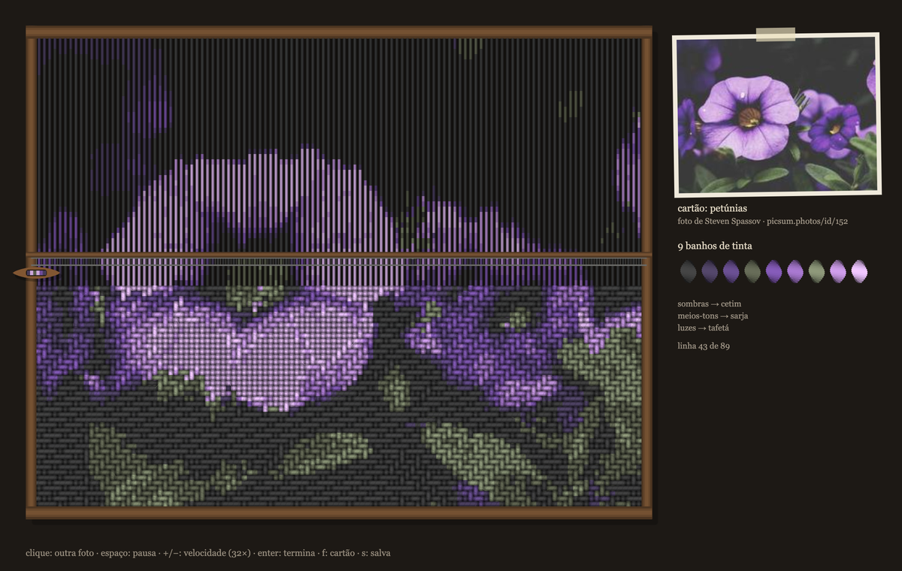

# Tear de Ikat

**Autor:** Victor Hugo Figueiredo Pereira da Silva

**Artefato da semana 08**, tema: *Imagem* (uma foto da internet lida como tabela de números).

Feito com o auxílio de IA (**AI**, **Claude**).

## Ideia do trabalho

Uma foto do **picsum.photos** vira um **tecido**, tecido fio a fio num tear na frente de quem assiste. A foto não é colada na tela: cada pixel vira uma decisão de tecelagem.

- **A cor tinge o fio (ikat).** No ikat, técnica tradicional da Indonésia, da Índia e da América do Sul, o fio é amarrado em feixes e tingido **antes** de ir para o tear. Por isso o desenho já está no fio esticado (dá para ver a foto "esticada" no urdume antes da trama passar), e as bordas das cores saem borradas e em degraus, porque os fios de um mesmo feixe se deslocam juntos.
- **O brilho escolhe o ponto (Jacquard).** O tear Jacquard (1804) lia cartões perfurados para decidir, cruzamento a cruzamento, se o fio vertical passa por cima ou por baixo do horizontal. Aqui é o brilho de cada pixel que decide: as sombras ficam em **tafetá** (um por cima, um por baixo), os meios-tons em **sarja** (a diagonal do jeans) e as luzes em **cetim** (fios longos e lisos). Algumas sementes invertem essa ordem.

Enquanto isso (por padrão em velocidade 32×; `-` desacelera para ver passada por passada) a **lançadeira** atravessa a linha indo e voltando, o **pente** bate cada passada contra o pano, e o tecido sobe de baixo para cima, como num tear de verdade. Ao lado fica o **cartão**, que é a foto original (no tear de tapeçaria, o cartão é o desenho que o tecelão segue), com o crédito do fotógrafo e as meadas dos banhos de tinta.

## Parte técnica (o que a aula de Imagem pede)

- **Imagem da internet com CORS, nenhuma imagem no zip.** A foto vem de `https://picsum.photos/id/<id>/<largura>/<altura>`. O picsum responde com `Access-Control-Allow-Origin: *`, e é isso que deixa ler os pixels sem erro de segurança. O tamanho pedido já tem a proporção do tecido.
- **`loadImage()` é assíncrono:** a função que monta o tear é `async` e espera a foto com `await`. Enquanto ela não chega, o tear mostra "urdindo o tear..."; se a internet falhar, aparece um aviso e um clique tenta outra foto.
- **Uma cópia reduzida:** `foto.get()` seguido de `resize(colunas, linhas)` deixa um pixel por cruzamento de fios. Depois, `loadPixels()` uma vez só e o laço lê o array `pixels` direto, com o índice `4 * (y * largura + x)`.
- **Brilho:** `0.222 r + 0.707 g + 0.071 b`, os mesmos pesos da aula.
- **Banhos de tinta por k-médias:** os pixels são agrupados nas *k* cores que melhor resumem a foto (com inicialização *k-means++*, para não perder uma cor pequena e importante, como o laranja da água-viva). Cada grupo é um banho de tinta.
- **Ikat:** a cor de cada trecho de fio é lida num pixel deslocado ao longo do próprio fio, por um ruído de Perlin que é o mesmo para todos os fios de um feixe.
- **Duas telas fora do vídeo (`createGraphics`):** uma com o urdume esticado e outra com o pano, desenhado aos poucos (só a célula que a lançadeira acabou de passar). Cada quadro mostra só a parte que interessa de cada uma com o `image()` de **9 argumentos** (onde desenhar e que pedaço usar).
- **Fio redondo:** cada trecho de fio é desenhado em tiras com sombreado de cilindro, as pontas escurecem onde o fio mergulha por baixo do vizinho, um risco diagonal marca a torção (urdume em S, trama em Z) e aparece uma fibrinha solta de vez em quando.
- **Lupa:** o mesmo `image()` de 9 argumentos amplia em 3,2× um pedaço pequeno do pano, recortado num círculo, para ver os fios passando por cima e por baixo.
- p5.js **2.0.5** carregado do CDN (cdnjs), sem a biblioteca no zip.

## O que a semente sorteia

A cada carregamento (e a cada clique) uma semente nova sorteia:

- a **foto**, entre oito escolhidas no picsum (água-viva, petúnias, urso, tigre, café, Golden Gate, flores e morangos); o clique sempre troca de foto;
- a **espessura do fio** e, com ela, quantos fios tem o tecido;
- o número de **banhos de tinta** (5 a 9);
- o tamanho dos **feixes do ikat** e quanto a cor **escorre** no urdume e na trama;
- os **limiares de brilho** entre tafetá, sarja e cetim, e a ordem deles;
- a **direção da diagonal** da sarja e se o cetim mostra a trama ou o urdume;
- a variação de **lote** de cada fio (nenhum fio sai exatamente da mesma cor).

## Controles

| ação | efeito |
| --- | --- |
| mover o mouse sobre o tear | lupa sobre os fios |
| clique (ou toque) | outra foto, tudo sorteado de novo |
| espaço | pausa / continua |
| `-` / `+` (ou ↓ / ↑) | desacelera / acelera a tecelagem (começa em 32×, o máximo; vai até 0,25×) |
| `Enter` | termina o tecido de uma vez |
| `f` | mostra / esconde o cartão |
| `s` | salva um PNG |

## Créditos das fotos (picsum.photos / Unsplash)

Marat Gilyadzinov (1069), Steven Spassov (152), Thomas Lefebvre (433), Paula Borowska (593), Justin Leibow (63), Ramiro Checchi (503), Cas Cornelissen (360) e veeterzy (1080).

## Como executar

Abra o `index.html` num navegador **com internet** (o p5.js e a foto vêm de fora), ou cole o `sketch.js` no editor do p5js.org (versão 2) ou no p5front.

## Prompt utilizado (plano de desenvolvimento)

1. **Escolher a leitura da imagem.** Em vez de redesenhar os pixels como formas soltas, tratar a foto como um tecido: cada pixel é um cruzamento entre um fio vertical (urdume) e um horizontal (trama).
2. **Buscar a foto com CORS.** Montar uma lista curta de fotos do picsum que funcionem em baixa resolução (formas grandes, cores fortes), pedir cada uma já na proporção do tecido e esperar a chegada com `async`/`await`, com aviso se a internet falhar.
3. **Reduzir e ler.** Copiar a foto, reduzi-la para uma célula por cruzamento de fios, ler o array `pixels` uma vez e calcular o brilho de cada célula.
4. **Tingir os fios.** Agrupar as cores da foto em poucos banhos de tinta (k-médias) e dar a cada trecho de fio a cor do seu banho, deslocada ao longo do fio por feixes, para imitar a borda borrada do ikat.
5. **Escolher o ponto pelo brilho.** Definir tafetá, sarja e cetim como regras de "o urdume passa por cima?" e escolher a regra de cada cruzamento pelo brilho, como no Jacquard.
6. **Desenhar o fio.** Sombreado de cilindro em tiras, pontas escurecidas onde o fio mergulha, risco de torção e fibras soltas, tudo desenhado numa tela fora do vídeo, uma célula de cada vez.
7. **Animar o tear.** Moldura de madeira, urdume esticado já tingido, lançadeira indo e voltando, pente batendo cada passada e o pano subindo de baixo para cima.
8. **Interação e ajuste fino.** Lupa com `image()` de 9 argumentos, cartão com a foto e o crédito, meadas dos banhos, controle de velocidade (começando em 32×), sorteio pela semente e layout que cabe no celular.
9. **Regras de entrega.** p5.js 2 via CDN, nenhuma imagem nem biblioteca no zip, README com as palavras-chave de IA e a coleção da semana, e zip com os arquivos direto na raiz.

## Arquivos

- `index.html`: página que carrega o p5.js 2 do CDN.
- `sketch.js`: o código do sketch.
- `thumbnail.png`: captura do resultado (só para a galeria; o sketch não a usa).
- `README.md`: este arquivo.
