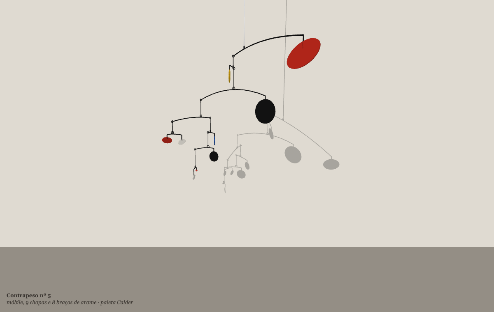

# Contrapeso

**Autor:** Victor Hugo Figueiredo Pereira da Silva

**Artefato da semana 09**, tema: *3D* (modo WEBGL, primitivas, câmera, luz e material).

Feito com o auxílio de IA (**AI**, **Claude**).

## Ideia do trabalho

Um **móbile** generativo, à maneira de **Alexander Calder** (1898–1976), o escultor americano que inventou o móbile nos anos 1930: chapas de metal pintadas presas em braços de arame, penduradas umas nas outras e **em equilíbrio**, girando devagar com o ar da sala.

Cada carregamento monta um móbile novo, pendurado numa sala de galeria (parede e chão), e calcula onde cada braço tem de ser preso para ficar na horizontal. Depois o ar faz o resto: uma brisa fraca mexe tudo o tempo todo, as chapas que estão de frente para o vento pegam mais força que as que estão de lado, e as partes de baixo, mais leves, giram mais depressa que as de cima, como num móbile de verdade. A luz projeta na parede e no chão as **sombras** do móbile, que nas exposições do Calder são quase uma segunda obra.

## Parte técnica (o que a aula de 3D pede)

- **Modo WEBGL:** `createCanvas(windowWidth, windowHeight, WEBGL)`, com a origem no centro e `z` saindo da tela.
- **Primitivas 3D, nenhuma malha pronta:**
  - **chapas** em pé ou deitadas: `cylinder()` bem achatado (2 de espessura), esticado com `scale()` para virar oval;
  - **pesos**: `ellipsoid()`; **anéis**: `torus()`;
  - **arame** dos braços, das hastes e dos fios: `cylinder()` fino, um pedaço reto para cada trecho, levado ao meio do trecho com `translate()` e alinhado com `rotateZ(atan2(-dx, dy))` (o eixo do cilindro é o `y`);
  - **argolas e ganchos** onde um braço se prende no outro: `torus()` pequeno;
  - **parede e chão**: `plane()`.
- **Hierarquia de transformações:** cada braço é desenhado dentro do sistema de coordenadas do braço de cima (`push`, `translate` até a ponta, `rotateY` do giro, ..., `pop`), exatamente como a lua no sistema da terra da aula. O braço de baixo não precisa saber onde está: só gira no próprio gancho.
- **Câmera:** `perspective()` e `camera()` chamados uma vez (no início, ao trocar de móbile e ao redimensionar), com a distância do olho calculada para o móbile caber em qualquer tela; `orbitControl()` deixa girar e aproximar com o mouse.
- **Luz:** `ambientLight()` (para a sombra não ficar preta), uma `directionalLight()` principal vinda do alto à esquerda e outra fraca e fria do lado oposto, de preenchimento.
- **Material:** `fill()` para a cor da tinta, `specularMaterial()` e `shininess()` para o brilho do metal (fosco na paleta Calder, polido na paleta Latão).
- **Sombras falsas com `applyMatrix()`:** o p5 não faz sombras (como mostra o slide do refletor). Então o móbile é desenhado mais duas vezes, sem luz e numa cor só, **achatado contra a parede e contra o chão** por uma matriz 4×4 de projeção paralela na mesma direção da luz direcional. Para a parede `z = P`, cada ponto vai para `x' = x + sx (z − P)`, `y' = y + sy (z − P)`, `z' = P`. As duas sombras são desenhadas sempre; o teste de profundidade esconde a parte de uma que cai "atrás" da outra (a sombra no chão que passaria para trás da parede, a da parede que desceria abaixo do chão), e fica certo até girando a câmera.

### O equilíbrio (lei da alavanca)

O móbile é uma **árvore**: cada braço tem um filho em cada ponta, que é uma chapa ou outro braço. Ela é montada de baixo para cima e, para cada braço, o ponto de suspensão fica à distância `a` da ponta esquerda tal que

`massaEsq × a = massaDir × (A − a) + o peso do próprio arame`

A massa de uma chapa é a sua área (os pesos maciços valem 5 vezes mais), e a massa de um braço é a soma de tudo o que está pendurado nele. O comprimento de cada braço também é calculado para os dois lados **nunca se baterem** ao girar: ou um lado fica inteiro abaixo do outro (e o fio do de baixo é alongado o quanto for preciso), ou o braço é mais comprido que a soma dos alcances dos dois lados.

### O ar

Cada braço tem um ângulo de giro em volta do próprio fio e uma velocidade. A cada quadro:

- o **vento** (brisa de ruído de Perlin + o sopro do teclado + o abano do mouse) empurra cada chapa **perpendicularmente a ela**: de frente pega muito, de lado quase nada;
- essa força, vezes a distância até o fio, dá o **torque**; dividido pela **inércia** do braço (soma de massa × distância²), dá a aceleração. Por isso os braços leves e curtos de baixo giram mais rápido;
- uma torção fraca do arame puxa de volta para a posição de repouso e o ar freia o giro;
- a força total do vento sobe pela árvore até o teto e faz o móbile inteiro **balançar** como um pêndulo.

## O que a semente sorteia

A cada carregamento (e a cada clique) uma semente nova sorteia:

- a **paleta**: *Calder* (muito vermelho e preto, um pouco de branco, amarelo e azul, tinta fosca), *Latão* (latão, cobre e aço polidos) ou *Terra* (terracota, verde-musgo, ocre);
- quantos **braços** tem a cascata (5 a 8) e onde nascem **galhos** curtos com duas chapas;
- para cada peça: se é chapa em pé, chapa deitada, peso ou anel; tamanho, proporção do oval, giro no próprio plano, cor e comprimento da haste;
- a **curvatura** de cada braço, o comprimento dos fios e se cada nível se separa do vizinho na vertical ou na horizontal;
- a posição de repouso de cada braço e o caráter da brisa.

O número da semente aparece na etiqueta, como o número de catálogo da obra. Para rever um móbile, acrescente `?semente=NÚMERO` ao endereço da página.

## Controles

| ação | efeito |
| --- | --- |
| arrastar | gira a câmera (`orbitControl`) |
| roda do mouse | aproxima / afasta |
| mover o mouse rápido | abana o móbile na direção do movimento |
| espaço | um sopro forte, de quem olha para o fundo da sala |
| clique (sem arrastar) | outro móbile, tudo sorteado de novo |
| `c` | volta a câmera para a vista inicial |
| `s` | salva um PNG |

## Como executar

Abra o `index.html` num navegador com internet (o p5.js vem do CDN), ou cole o `sketch.js` no editor do p5js.org (versão 2) ou no p5front.

## Prompt utilizado (plano de desenvolvimento)

1. **Escolher o objeto.** Um móbile de Calder usa justamente o que a aula ensina: primitivas simples (discos, arame, argolas), hierarquia de transformações (cada braço preso no outro) e luz com sombra, que no Calder faz parte da obra.
2. **Montar a árvore.** Gerar recursivamente uma cascata de braços, cada um com uma chapa numa ponta e o resto do móbile na outra, com galhos curtos de vez em quando, e sortear o tipo, o tamanho e a cor de cada peça.
3. **Equilibrar.** De baixo para cima, somar as massas e achar o ponto de suspensão de cada braço pela lei da alavanca; dimensionar braços e fios para nenhuma parte bater em outra ao girar.
4. **Desenhar com primitivas.** Chapas com `cylinder` achatado e escalado, pesos com `ellipsoid`, anéis e ganchos com `torus`, arame em pedaços de `cylinder`, tudo dentro de `push`/`translate`/`rotateY`/`pop` seguindo a árvore.
5. **Sala, câmera e luz.** Parede e chão com `plane`, câmera em perspectiva enquadrando o móbile em qualquer tela, `orbitControl`, luz ambiente + direcional, material fosco ou polido conforme a paleta.
6. **Sombras.** Como o p5 não faz sombras, projetar o móbile na parede e no chão com `applyMatrix`, na direção da luz, numa cor só, um pouco à frente das superfícies.
7. **Física do ar.** Torque do vento sobre cada chapa conforme a orientação, inércia de cada braço, torção e atrito; balanço do móbile inteiro no fio do teto.
8. **Interação e ajuste fino.** Sopro no espaço, abano pelo mouse, clique para outro móbile, etiqueta de museu com o número da semente, ajuste de luz e cores, e teste de várias sementes e de tela de celular.
9. **Regras de entrega.** p5.js 2 via CDN, sem a biblioteca no zip, README com as palavras-chave de IA e a coleção da semana, e zip com os arquivos direto na raiz.

## Arquivos

- `index.html`: página que carrega o p5.js 2 do CDN.
- `sketch.js`: o código do sketch.
- `thumbnail.png`: captura do resultado (só para a galeria; o sketch não a usa).
- `README.md`: este arquivo.
