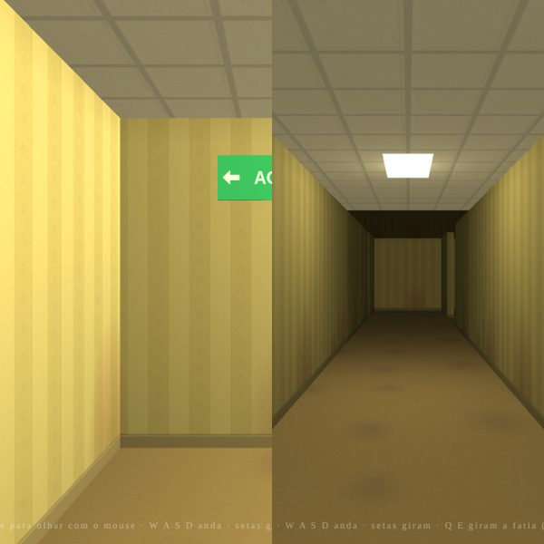

# De costas

**Autor:** Murilo Jorge de Figueiredo

## De onde vem a ideia

A ideia vem de um jogo que eu comecei a fazer quando era criança, num curso de
jogos em Unity para crianças, e que **nunca terminei**. Era um labirinto em que o
ponto de vista mudava o que de fato acontecia: um corredor todo branco em que
não se vê nada, um corredor que, quando você se vira para olhar, já é outra
coisa, um corredor que se encaixa em outro. O projeto final é a chance de
terminar esse jogo, agora no p5.js.

## A ideia

Um labirinto em primeira pessoa feito de **ilusões de espaço**: corredores que
continuam em outro lugar, passagens que viram o mundo do avesso, lugares maiores
por dentro que por fora, um mundo sem borda, um labirinto em quatro dimensões e
coisas que mudam quando você não está olhando. Tudo na linguagem de salas,
corredores e labirintos. O labirinto é gerado proceduralmente a cada partida e
**sempre tem saída**, por mais que mude.

O clima é o dos **espaços liminares** e das *Backrooms*: corredores de escritório
vazios, papel de parede amarelo manchado de umidade, carpete úmido, forro de
placas e luminárias fluorescentes que zumbem e às vezes piscam. É um lugar de
passagem que parece familiar e não é de ninguém, sem nenhuma ameaça visível. O
desconforto vem só do espaço: ele se repete, não tem fim e não obedece à
geometria. As placas de **SAÍDA** apontam o caminho de verdade, mas uma em cada
cinco mente. Os bilhetes colados nas paredes dizem "não olhe para trás" e "você
já passou aqui", e o labirinto faz isso ser verdade.

O principal recurso para os espaços impossíveis são **portais sem moldura**: uma
passagem comum que, sem nenhum aviso, continua em outro ponto do labirinto. O
que se vê por ela é o lugar de destino de verdade, então nada denuncia a costura.
O corredor parece seguir reto, mas você está em outro lugar, às vezes virado
90° ou 180°, às vezes espelhado.

## O que esta primeira versão explora

Esta primeira entrega experimenta várias ideias de uma vez. Cada uma está
funcionando, mas em forma de esboço; o acabamento fica para as próximas etapas.

- **Labirinto sempre resolvível.** O labirinto é cavado como uma **árvore**
  (busca em profundidade a partir da entrada): existe exatamente um caminho
  entre quaisquer duas células, então existe caminho até a saída, que é a célula
  mais distante da entrada. As passagens da árvore nunca se fecham.
- **O mundo é um toro.** Não há borda: quem sai pelo leste entra pelo oeste, quem
  sai pelo sul entra pelo norte. Esse espaço é desenhado de verdade, não
  simulado: o labirinto aparece repetido em volta de si mesmo (3 × 3 cópias), e
  um corredor que atravessa a "borda" continua sem emenda. Dá para andar em
  linha reta e voltar ao mesmo lugar.
- **Portas instáveis.** Algumas paredes fora da árvore ora são parede, ora são
  passagem. Elas só trocam de estado depois de você ter passado perto e quando
  saem do seu campo de visão. Você olha um corredor, se vira, volta a olhar, e
  ele já não é o mesmo. Como só criam ou desfazem atalhos, o labirinto continua
  resolvível.
- **Portais.** Duas a quatro duplas de passagens comuns são ligadas entre si.
  Atravessar uma leva à outra, girado do jeito que for preciso para o corredor
  continuar: quem anda reto continua andando reto, mas em outro lugar e em outra
  direção. Pela passagem se vê o destino, desenhado em tempo real. Ela vale dos
  dois lados: quem vem de trás chega ao outro lado do outro portal. Um corredor
  pode levar a ele mesmo por outro lado, e dois corredores paralelos podem dar um
  no outro. Cada dupla só é aceita se, depois dela, ainda houver caminho até a
  saída.
- **O portal espelhado.** Uma das duplas (lilás no mapa) é uma **reflexão**, não
  uma rotação: quem passa sai **espelhado**, como numa fita de Möbius. O mundo
  inteiro troca de mão, o que estava à esquerda fica à direita, e uma segunda
  travessia desfaz. Pela passagem já se vê o outro lado refletido. As **placas e
  os bilhetes** nas paredes têm texto: do outro lado, "SAÍDA" aparece escrito ao
  contrário, e é assim que se percebe ter virado do avesso. Na tela, o espelho é
  a imagem refletida, e os controles também se invertem para continuar fazendo
  sentido.
- **Maior por dentro.** Num beco sem saída, o beco não termina: a passagem para
  ele é um portal para um **corredor comprido** que dá num **salão** com o
  triplo do pé-direito do labirinto, que não caberia em lugar nenhum dele. De
  fora já se vê o corredor longo onde deveria haver um beco. De dentro do
  corredor, olhando para trás, se vê o labirinto. A volta leva ao mesmo lugar,
  olhando para o lado certo.
- **O labirinto em quatro dimensões.** O salão do beco é um **labirinto 4D**:
  5 × 5 × 3 células em x, z e w, todas do mesmo tamanho, com paredes que são
  caixas 4D nas três orientações. Você nunca vê o 4D inteiro, só uma **fatia 3D**:
  o plano que passa por você, formado pela sua frente e pela vertical. **Q** e **E**
  **giram essa fatia** entre x e w, em volta de você. Essa é a mecânica de
  *Miegakure* e *4D Miner*, que a pesquisa apontou como o que dá a sensação de
  4D. Uma primeira versão em camadas de w parecia só "trocar de andar".
  - Andar é sempre andar na fatia. Com ela girada, ir em frente é ir, em parte
    ou de todo, pela quarta dimensão.
  - Ao girar, os corredores **esticam, se fundem e se abrem** continuamente. As
    paredes "de w", invisíveis com a fatia reta, viram paredes comuns quando ela
    gira, e as de x somem.
  - O **tom** de cada parede diz a orientação dela: amarelo para x, esverdeado
    para z, azul para w. A borda do labirinto 4D é escura. A régua embaixo mostra
    quanto a fatia está girada.
  - A **saída** fica numa célula sem porta em nenhuma das suas paredes 3D. Só se
    entra nela pela quarta dimensão, como a casa trancada de *Miegakure*.
  - No alto flutuam um **tesserato** e uma **hiperesfera**, fatiados pelo mesmo
    plano. A forma deles muda conforme você gira: uma bússola da quarta
    dimensão.
  - Não se gira a fatia para dentro de uma parede.
  - O corredor de entrada é um corredor 3D comum. Lá a fatia volta a ficar
    reta sozinha, e ele só se liga à camada de entrada do labirinto 4D.
- **Níveis.** A saída é uma porta solta no meio de uma sala, com luz do outro lado (dos dois lados). Ao passar por ela, um labirinto novo e
  maior é gerado.
- **O mapa** (tecla M), visto de cima, entrega os truques: portas instáveis em
  vermelho, os portais em duplas da mesma cor (o espelhado em lilás), o beco
  maior por dentro em azul, e nenhuma borda.

No thumbnail, à esquerda, uma passagem que é o portal espelhado: através dela a
placa de SAÍDA aparece escrita ao contrário. À direita, o beco maior por dentro:
onde deveria haver uma parede, um corredor comprido.

**Testes.**
- **Portais.** Em 30 labirintos gerados, todos com saída alcançável (os
  portais contam, as portas instáveis contam como fechadas), andamos através de
  cada portal: em 120 travessias, o jogador sempre sai do lado certo do portal
  de destino, olhando na direção dele. As travessias espelhadas trocam a mão do
  mundo e as outras não.
- **O beco maior por dentro.** Nos 30, ele leva à sala, dá para andar pelo
  corredor e voltar ao labirinto.
- **O labirinto 4D.** Em 60 labirintos 4D gerados, todos têm saída, e em todos
  ela está trancada em 3D (sem nenhuma ligação em x ou z). O caminho mais curto
  até ela tem em média cerca de 10 células e 3 passagens pela quarta dimensão.
  Com a fatia girada a 90°, andar em frente atravessa para a camada vizinha só
  onde há passagem; com a fatia reta, andar não muda w.
- **Teclado e erros.** W A S D, setas, Q/E e M foram testados com o teclado de
  verdade, e o console não mostra erros.

## Como é feito

- **Nenhum arquivo de imagem nem de som.** As texturas (papel de parede amarelo
  com padrão, manchas e rodapé; carpete; forro de placas; placas de SAÍDA e
  bilhetes) são desenhadas pelo próprio sketch uma vez, em canvases 2D feitos com
  `createGraphics()`, e usadas com `texture()`. O texto usa a fonte padrão.
- **O zumbido** é sintetizado com a Web Audio API do navegador: osciladores em
  60 Hz e harmônicos, passando por um filtro, e um chiado agudo bem baixo. O
  volume sobe perto de uma luminária acesa. Começa no primeiro clique ou tecla,
  como o navegador exige.
- As placas de SAÍDA usam a distância de cada célula até a saída pela árvore
  (busca em largura): a seta aponta para o lado da parede em que fica o próximo
  passo do caminho, e 20% das placas são invertidas de propósito.
- As paredes são caixas montadas com `beginShape(QUADS)`, `normal()` e
  `vertex(x, y, z, u, v)`, com as coordenadas de textura em unidades do mundo
  (`textureWrap(REPEAT)`): o papel de parede continua de uma parede para a outra
  e não estica nas pontas.
- As paredes, o chão, o teto, as placas e as luminárias de cada nível
  viram `p5.Geometry`, montadas uma vez com `buildGeometry()` e desenhadas com
  `model()` nove vezes (o toro), uma malha por textura. As luminárias que piscam
  ficam em malhas separadas, acesas ou apagadas a cada quadro. As anteriores são
  liberadas com `freeGeometry()`. As portas instáveis mudam, então ficam fora
  dessas malhas: cada uma tem a sua, desenhada só quando está fechada.
- Para desenhar, cada parede vai só de um canto ao outro, e cada canto da grade
  é um poste à parte: duas paredes nunca se sobrepõem, então nunca há duas
  superfícies brigando pelo mesmo pixel.
- A luz é uma `ambientLight()` amarelada e as quatro luminárias acesas mais
  perto, cada uma um `pointLight()`, com `lightFalloff()`.
- **Portais.** Cada ponta de portal ("boca") tem um centro c, uma normal n e uma
  matriz M (2 × 2) que leva direções daqui para lá. M é uma rotação, ou uma
  reflexão no portal espelhado (F = 2nnᵀ − I aplicada depois da rotação). Um
  ponto p perto da boca corresponde a c' + M (p − c) do outro lado.
  - Atravessar é aplicar isso à posição e à direção do jogador.
  - Ver através é desenhar o mundo, num `createFramebuffer()`, de um ponto de
    vista virtual: os olhos do jogador levados para o outro lado.
  - Um `baseMaterialShader().modify()` acrescenta ao material padrão do p5 um
    plano de corte: os pixels do lado do olho virtual são descartados, para que
    nada entre ele e o portal de destino tampe a vista.
  - A boca é uma placa fina pintada por um segundo shader, que lê o framebuffer
    na mesma posição da tela (`gl_FragCoord`). Assim a imagem se encaixa pixel a
    pixel, de qualquer ângulo. No portal espelhado, a leitura é invertida na
    horizontal.
  - Por quadro, até dois portais visíveis são desenhados (os mais próximos).
    Cópias do toro inteiras atrás da câmera não são desenhadas.
- **Caminho até a saída.** A busca em largura atravessa os portais: quem entra
  pela célula de trás de uma boca sai pela célula da frente da outra, e vice-versa.
- "Fora do campo de visão" é o ângulo entre a direção do olhar e a direção até a
  porta, comparado com a metade da abertura horizontal da câmera, mais uma folga.
  No toro, a distância é sempre até a cópia mais próxima.
- O labirinto 4D é uma lista de **caixas 4D** (intervalos em x, z e w). A fatia
  é a reta, no plano x–w, que passa pelo jogador na direção (cos θ, sen θ). A
  fatia de uma caixa é o intervalo dessa reta dentro do retângulo [x0, x1] ×
  [w0, w1], calculado pelo método das placas (o mesmo de raio contra caixa).
  Como z e a altura não mudam, a fatia de uma caixa 4D é sempre uma caixa 3D,
  desenhada como as paredes do labirinto, com um tom diferente para cada
  orientação (as paredes de w são azuladas). O mundo é desenhado nas coordenadas da fatia (o jogador
  em u = 0), e a colisão é feita contra essas mesmas caixas.
- Andar move o jogador ao longo da fatia: x += du · cos θ, w += du · sen θ.
  Girar muda θ em volta do próprio jogador, e só é permitido se ele não ficar
  dentro de uma parede.
- A saída é uma célula-folha da árvore. Se ela se liga ao resto por x ou z, essa
  ligação é fechada e outra é aberta em w. Como continua sendo folha, a árvore
  continua árvore. Depois, algumas paredes a mais se abrem como atalhos (nunca as
  da saída).
- As fatias do tesserato e da hiperesfera são malhas comuns, refeitas a cada
  quadro. Cada vértice vai para as coordenadas da fatia (u, y, z, n), em que n é
  a distância até ela.
  - A fatia da hiperesfera é uma `sphere()` de raio √(r² − n²).
  - A do tesserato sai de cortar cada uma das 8 células cúbicas dele em n = 0.
    Os pontos onde as arestas atravessam a fatia formam um polígono; ordenados
    em volta do centro, viram uma face. As faces são orientadas para fora e
    montadas numa `p5.Geometry` com normais `FLAT` (`computeNormals()`). A malha
    do quadro anterior é liberada com `freeGeometry()`.

## O que pretendo acrescentar até a etapa final

1. **Portais mais estranhos.** Portais com escala (uma porta que leva a uma
   versão menor ou maior do mesmo corredor), portais que mudam de destino
   quando ninguém está olhando, um corredor que leva a ele mesmo por trás (você
   vê suas próprias costas, o que daria sentido ao nome do jogo), e portais
   vistos através de portais (recursão), que hoje mostram o lugar real.
2. **Mais puzzles em 4D.** Fantasmas discretos das paredes logo "ao lado" em w
   (como em *4D Golf*), para enxergar o que vai aparecer antes de girar. Salas
   que introduzam o 4D aos poucos (primeiro objetos 3D "esticados" em w, depois
   formas 4D de verdade, como recomenda a equipe de *Miegakure*). Objetos 4D que
   é preciso girar até a fatia deles deixar uma fresta. Som como bússola, mudando
   com o ângulo da fatia.
3. **A casa-tesserato.** Oito salas cúbicas ligadas como as células de um
   hipercubo, em que cada porta leva a outra sala. Andando sempre em frente,
   passa-se por quatro portas e volta-se à primeira. É o conto *"—And He Built a
   Crooked House"*, de Robert Heinlein.
4. **Outras topologias.** Uma garrafa de Klein (o toro com uma das voltas
   espelhada, agora possível com o portal espelhado), um corredor em espiral que
   nunca sobe nem desce, salas que se empilham no mesmo lugar.
5. **Mais estruturas de ponto de vista:** uma porta que leva a lugares
   diferentes conforme o lado de onde se olha, um corredor que só existe
   enquanto você olha para trás, uma sala que muda quando você pisca.
6. **Mudanças no próprio caminho**, não só nos atalhos, verificando a cada troca,
   com uma busca no grafo, que ainda existe caminho até a saída.
7. **Mais estranhamento liminar:** salas que se repetem idênticas, uma piscina
   vazia, escadas que não levam a lugar nenhum, um corredor comprido demais (que
   se alonga enquanto se anda), luzes que se apagam atrás de você, passos no
   carpete que continuam um instante depois que você para.
8. **Acabamento:** transições entre níveis, uma sequência de níveis que apresente
   cada ilusão aos poucos, e uma pequena narrativa ou objetivo.

## Como jogar

Abra o `index.html` no navegador e clique na tela.

| Controle | Ação |
|---|---|
| **clique** | prende o mouse para olhar (Esc solta) |
| **mouse** (ou arrastar, ou ← →) | girar |
| **W A S D** (ou ↑ ↓) | andar |
| **Q / E** | girar a fatia entre x e w (na sala 4D) |
| **M** | mapa visto de cima |
| **N** | liga e desliga o som |
| **R** | outro labirinto |

Se o ambiente não deixar prender o mouse, arrastar com o botão pressionado
também gira a visão. O canvas usa `windowWidth` e `windowHeight`. O p5.js
(versão 2.3.4) é carregado de CDN e não está no zip.
