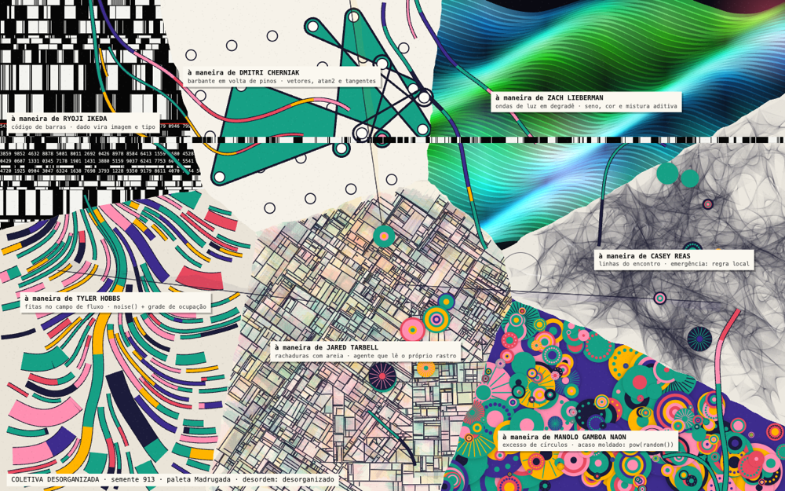

# Coletiva Desorganizada

**Autor:** Victor Hugo Figueiredo Pereira da Silva

**Projeto final, parte 1** (primeira de três entregas).

Feito com o auxílio de IA (**AI**, **Claude**).

## Homenagem

Sete artistas digitais de hoje dividem a mesma folha. Nenhuma obra é copiada:
de cada um eu peguei só a **marca registrada**, o gesto que faz a gente
reconhecer o autor de longe, e reescrevi do zero com o que vimos nas aulas.

| artista | a marca dele | como aparece no sketch | conceito da disciplina |
|---|---|---|---|
| [Tyler Hobbs](https://www.tylerxhobbs.com/words/fidenza) (*Fidenza*) | fitas coloridas que seguem um campo de fluxo sem se tocar | fitas em trechos de cor, com grade de ocupação | `noise()` e campo de fluxo (aula 4) |
| [Dmitri Cherniak](https://www.dmitricherniak.com/) (*Ringers*) | um barbante esticado em volta de pinos | retas tangentes e arcos em volta de uma grade de pinos, um pino colorido | vetores, `atan2`, coordenadas polares (aula 3) |
| [Manolo Gamboa Naon](https://www.behance.net/manoloide) | excesso de círculos concêntricos saturados | anéis, rodas raiadas e colares de pontos, do maior para o menor | acaso moldado com `pow(random())` (aula 4) |
| [Zach Lieberman](https://www.instagram.com/zach.lieberman/) | ondas de luz em degradê sobre o escuro | faixas em seno somadas em modo `screen`, com halos | seno, cor e mistura aditiva (aulas 2 e 3) |
| [Jared Tarbell](http://www.complexification.net/gallery/machines/substrate/) (*Substrate*) | rachaduras retas com aquarela de areia | agentes que anotam o ângulo numa grade e renascem perpendiculares | agente que lê o próprio rastro (aula 5) |
| [Casey Reas](https://reas.com/) (*Process*) | linhas que nascem do encontro de círculos | círculos invisíveis andam; quando dois se tocam, uma linha liga os centros | emergência: regra local, forma global (aulas 5 e 6) |
| [Ryoji Ikeda](https://www.ryojiikeda.com/) (*test pattern*, *datamatics*) | código de barras, o dado em preto e branco | fileiras de barras, números miúdos e uma linha vermelha | dado que vira imagem e tipografia (aulas 6 e 7) |

## Ideia do trabalho

Uma exposição coletiva costuma ser arrumada: cada artista na sua parede, com a
sua etiqueta. Aqui a exposição não coube nas paredes. A folha é rasgada em
sete territórios e cada artista pinta o seu, todos ao mesmo tempo, na frente de
quem assiste. Quando terminam, ninguém respeita a fronteira: as fitas do Hobbs
atravessam a folha, o barbante do Cherniak é espetado no vizinho, o confete do
Gamboa espirra, a luz do Lieberman vaza pela fresta, as rachaduras do Tarbell
cortam a moldura, os círculos do Reas aparecem do lado de fora e uma tira de
código de barras do Ikeda risca tudo de lado a lado.

O título resume a regra do trabalho, que eu chamo de **harmonicamente
desorganizado**:

- **O que dá harmonia:** uma única semente, uma única paleta e um único campo
  de ruído. O mesmo campo guia as fitas do Hobbs, a direção das primeiras
  rachaduras do Tarbell, a inclinação da grade de pinos do Cherniak e para
  onde o confete do Gamboa espirra.
- **O que dá desordem:** as bordas rasgadas e as invasões. A tecla `D` muda o
  nível: *arrumado* (bordas retas, ninguém invade), *desorganizado* e *caos*.

É também um resumo do que eu mais gostei na disciplina: campo de fluxo
(artefato 04), agentes e emergência (05 e 06), a obra sendo feita ao vivo, a
semente que repete a obra e a etiqueta de museu que explica o que se vê.

## Parte técnica

### A folha rasgada

1. **Sete pontos bem espalhados.** Uso o "melhor candidato" de Mitchell
   (aula 4): para cada ponto sorteio 40 candidatos e fico com o que está mais
   longe dos pontos já colocados.
2. **Território de cada ponto.** É o diagrama de Voronoi: começo com a folha
   inteira e corto fora, vizinho por vizinho, a metade que está mais perto do
   vizinho (produto escalar com a mediatriz).
3. **Rasgo.** Cada lado é dividido em pedacinhos e cada ponto é empurrado por
   `noise()`. Como o empurrão só depende da posição, dois vizinhos rasgam o
   lado comum do mesmo jeito e as bordas continuam encaixando.
4. **Recorte.** Cada artista pinta preso ao seu território com
   `drawingContext.clip()`. As invasões são desenhadas depois, sem recorte.

### Pintura ao vivo

Cada artista é uma função geradora (`function*`). A cada quadro o `draw()` dá
alguns milissegundos para cada uma e ela continua de onde parou no `yield`.
Assim os sete pintam juntos sem travar a página.

### Os sete algoritmos

- **Hobbs:** segue o ângulo do campo passo a passo; cada fita pronta registra
  seus pontos numa grade, e a próxima para quando encosta em alguma.
- **Cherniak:** entre dois pinos o barbante é uma tangente aos dois círculos
  (externa se passa pelo mesmo lado, interna se cruza); em cada pino, um arco.
- **Gamboa Naon:** 170 círculos de três tipos, com raio caindo por `pow()`.
- **Lieberman:** 64 faixas `sin()` com degradê em HSL e mistura `screen`.
- **Tarbell:** rachaduras gravam o ângulo numa grade; quem bate em outra
  renasce em ângulo reto; um raio perpendicular pinta a areia.
- **Reas:** círculos invisíveis vagam; se a distância é menor que a soma dos
  raios, traço uma linha quase transparente entre os centros.
- **Ikeda:** barras de largura `pow(random())`, fileiras de dígitos e uma linha
  vermelha.

## O que a semente sorteia

- a paleta (Risografia, Itacoatiara, Madrugada ou Feira) e a ordem das cores;
- a posição dos sete territórios e qual artista fica em cada um;
- o campo de ruído (e, com ele, o rasgo das bordas e a direção das fitas);
- tudo dentro de cada território: fitas, pinos, círculos, ondas, rachaduras,
  agentes, barras e as invasões.

A semente aparece na legenda. `?semente=913` na URL repete uma obra.

## Controles

| ação | efeito |
|---|---|
| clique ou `N` | nova obra (nova semente) |
| `R` | refaz a mesma obra |
| `D` | nível de desordem: arrumado, desorganizado, caos |
| `H` | mostra ou esconde as etiquetas |
| `ESPAÇO` | termina a pintura sem animar |
| `S` | salva um PNG com a semente no nome |

## Ideias para o projeto final e o que pretendo acrescentar até a 3ª entrega

Esta primeira entrega é a base: a folha rasgada, os sete artistas em 2D e as
invasões. O plano para as próximas duas:

**2ª entrega (mais conceitos da disciplina dentro da coletiva)**

- **Refik Anadol com shader** (aula 10): um território pintado por um
  fragment shader de *fbm* com *domain warping*, como pigmento fluido.
- **Tipografia como matéria** (aula 6): as etiquetas deixam de ser só texto;
  o nome de cada artista é extraído com `textToPoints` e desenhado pelo
  algoritmo do próprio artista (o nome do Hobbs em fitas, o do Tarbell em
  rachaduras).
- **Imagem** (aula 7): uma foto vinda por URL serve de "modelo vivo" e cada
  território a interpreta do seu jeito (brilho vira largura de fita,
  densidade de barras, tamanho de círculo).
- **Invasões mais ricas:** em vez de só passar por cima, o invasor adota a
  técnica do território invadido (uma fita do Hobbs que vira código de barras
  ao entrar no Ikeda).

**3ª entrega (interação e acabamento)**

- **Curadoria com o mouse:** arrastar um ponto muda o território ao vivo;
  clicar numa etiqueta troca o artista daquela parede.
- **Um território em 3D** (aulas 8 e 9): cubos à maneira de Manfred Mohr ou uma
  malha `p5.Geometry` renderizada em um `createGraphics(WEBGL)`.
- **Modo "visita guiada":** a câmera aproxima de cada território e mostra o
  mecanismo por trás (o campo de fluxo, a grade de ocupação, os círculos
  invisíveis do Reas).
- Filtro final em shader (grão e leve aberração) e ajuste fino das paletas.

## Como executar

Abra o `index.html` em um navegador, ou carregue o zip no
[p5Front](https://esperanc.github.io/p5front/). O p5.js 2 vem por CDN
(`cdn.jsdelivr.net/npm/p5@2.2.3`); não há imagens nem bibliotecas no zip.

## Prompt utilizado

> Faça o meu projeto final de Programação Criativa (parte 1) em p5.js.
>
> **Enunciado do professor:** "Seu projeto final é individual e será
> desenvolvido ao longo de 3 semanas. Na primeira semana você deve entregar
> sua primeira implementação exatamente como se fosse um artefato da semana.
> No README.md use como nome da collection a string `projeto final/seu nome/1`,
> onde "seu nome" é o seu nome como aparece na plataforma do classroom. Não
> esqueça também de: 1) colocar as tags de AI e outras que julgar relevante.
> No README.md também escreva suas ideias para o projeto final e o que você
> pretende acrescentar até a etapa final (3a entrega). 2) o arquivo
> thumbnail.png. 3) testar o seu programa! Preste atenção nas mensagens de
> erro mostradas pelo p5front, mas às vezes omitidas pelo editor do p5 e
> outras plataformas."
>
> **Tema.** Quero uma mistura de vários dos artistas digitais mais
> importantes da atualidade, pegando a marca registrada de cada um e juntando
> todas no mesmo sketch de forma harmonicamente desorganizada, mostrando os
> conceitos de que mais gostei na disciplina. O nome é "Coletiva
> Desorganizada": uma exposição coletiva que não coube nas paredes.
>
> **A folha.** Sorteie sete pontos bem espalhados na janela (melhor candidato
> de Mitchell, 40 candidatos por ponto) e dê a cada um o seu território de
> Voronoi. Rasgue as bordas dos territórios empurrando os pontos de cada lado
> com `noise()` que só dependa da posição, para os vizinhos continuarem
> encaixando. Cada território vai para um artista sorteado, que pinta preso
> a ele com `drawingContext.clip()`.
>
> **Os sete artistas e suas marcas** (nada copiado de obra nenhuma, só o
> gesto, escrito do zero):
> 1. Tyler Hobbs: fitas que seguem um campo de fluxo sem se sobrepor (grade
>    de ocupação), com contorno escuro e divididas em trechos de cor.
> 2. Dmitri Cherniak: grade de pinos e um barbante fechado esticado em volta
>    de alguns deles (tangentes externas e internas entre círculos, arco em
>    cada pino), forma preenchida e um pino colorido.
> 3. Manolo Gamboa Naon: uns 170 círculos saturados, do maior para o menor,
>    de três tipos: anéis concêntricos, roda raiada e colar de pontos.
> 4. Zach Lieberman: fundo escuro e 64 faixas em onda (seno) com degradê em
>    HSL somadas em modo `screen`, mais alguns halos de luz.
> 5. Jared Tarbell: rachaduras retas que anotam o ângulo numa grade, param
>    ao bater em outra e renascem perpendiculares, com pintura de areia ao
>    lado.
> 6. Casey Reas: círculos invisíveis que vagam; quando dois se tocam, uma
>    linha quase transparente liga os centros.
> 7. Ryoji Ikeda: fundo preto, fileiras de barras brancas de larguras
>    sorteadas, fileiras de números miúdos e uma única linha vermelha.
>
> **Harmonia.** Uma única semente, uma única paleta (sortear entre
> Risografia, Itacoatiara, Madrugada e Feira, com cores de peso diferente) e
> um único campo de ruído que oriente todo mundo: as fitas, as primeiras
> rachaduras, a inclinação da grade de pinos e a direção do confete.
>
> **Desordem.** Depois que todos terminam, cada artista invade os vizinhos
> sem recorte: fitas finas atravessam a folha, um barbante é espetado fora,
> círculos espirram como confete, a luz vaza pela fronteira, rachaduras
> cortam a moldura, os círculos do Reas aparecem e uma tira de código de
> barras risca a folha de lado a lado. A tecla `D` alterna três níveis:
> arrumado (bordas retas, sem invasão), desorganizado e caos.
>
> **Pintura ao vivo.** Os sete pintam ao mesmo tempo, na frente de quem
> assiste; cada artista é uma função geradora e o `draw()` dá alguns
> milissegundos para cada uma por quadro. No fim, grão de papel por cima.
>
> **Etiquetas.** Em cada território, uma etiqueta de museu com "à maneira de
> NOME", a marca do artista e o conceito da disciplina usado. Embaixo, uma
> legenda com o título, a semente, a paleta e o nível de desordem.
>
> **Controles.** Clique ou `N`: nova obra. `R`: refazer. `D`: desordem.
> `H`: etiquetas. `ESPAÇO`: terminar sem animar. `S`: salvar PNG com a
> semente no nome. `?semente=N` na URL repete uma obra. Ao redimensionar a
> janela, refazer a mesma obra no tamanho novo, com tudo proporcional ao
> menor lado.
>
> **Entrega.** p5.js versão 2 por CDN, sem biblioteca no zip; código e
> comentários em português, explicados para qualquer colega entender;
> `index.html`, `sketch.js`, `README.md` e `thumbnail.png` direto na raiz do
> zip.

## Arquivos

- `index.html`: página que carrega o p5.js 2 e o sketch
- `sketch.js`: o código, comentado em português
- `thumbnail.png`: captura da obra (semente 913)
- `README.md`: este arquivo
