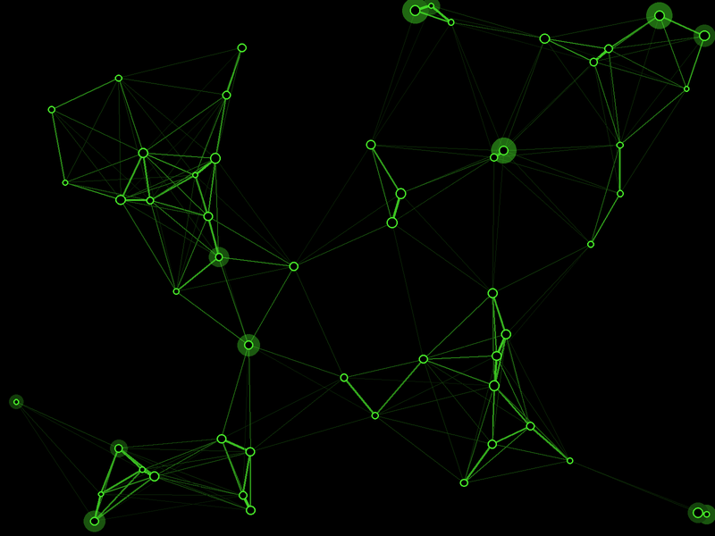

# Geometric Motion — Bolinhas em Rede

**Collection:** projeto final/Júlia Vilela/1

**Tags:** AI, generative art, geometric motion, p5.js, physics, bouncing balls, collision, network, graph, animation

## Descrição

Esboço em p5.js inspirado em vídeos de *geometric motion art* e nos clássicos jogos de bolinhas que ricocheteiam nas paredes. Sobre um fundo preto, pequenas bolinhas verdes e vazadas vão surgindo uma a uma, cada uma com um anel que se expande no momento em que aparece. Na maior parte das vezes a nova bolinha nasce perto de uma que já existe, e assim a rede parece brotar de si mesma; de vez em quando ela surge num ponto qualquer da tela e começa um novo aglomerado.

Cada bolinha anda em linha reta, ricocheteia ao tocar as bordas da tela e bate nas outras bolinhas em choques elásticos, trocando de direção como num jogo de bilhar. A cada impacto, com a parede ou com outra bolinha, acende um pequeno clarão verde.

Enquanto se movem, as bolinhas formam um grafo que muda o tempo todo. Quando duas delas ficam a menos de uma distância máxima, uma linha cresce da mais antiga em direção à mais nova. A espessura e o brilho da linha aumentam à medida que as bolinhas se aproximam, o que destaca triângulos e polígonos dentro de uma teia de ligações mais finas. Quando elas se afastam demais, a linha se recolhe e desaparece. Depois que todas as bolinhas nasceram, a composição continua em movimento por cerca de 10 segundos, esmaece e recomeça com uma nova formação aleatória.
