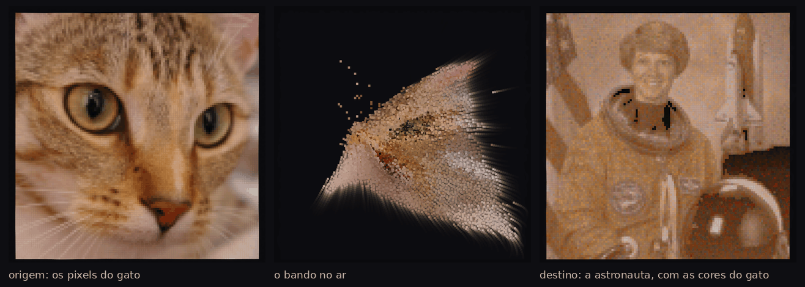

# Revoada

**Autor:** Murilo Jorge de Figueiredo

## O que é

Os pixels de uma foto viram pássaros e voam em bando para formar outra foto,
usando as cores da primeira. A segunda foto é montada inteira com os pixels da
primeira: nenhuma cor é criada, só trocada de lugar.

## As fotos

A cada execução, duas fotos são sorteadas no **picsum.photos**, um servidor com
CORS, e baixadas com `loadImage()`. Cada uma é cortada num quadrado e reduzida a
uma grade de 120 × 120. Os pixels são lidos como dados: os da **origem** viram
os 14 400 pássaros, cada um com a sua cor; a foto de **destino** só dá a forma.
O sketch não inclui nenhuma imagem.

## Quem vai para onde

Cada pixel da origem precisa de um lugar no destino onde a cor dele se pareça
com a que estava ali. Os pixels das duas fotos são ordenados do mais escuro ao
mais claro e casados pela posição na ordem; depois, dezenas de milhares de
**trocas** aleatórias refinam o casamento, sempre que trocar dois pixels de
lugar diminui o erro de cor. As trocas acontecem enquanto o bando voa, e os
pixels vão corrigindo a rota no ar.

Testamos outros métodos. Ordenar pela curva de Hilbert no cubo de cores, que
tenta casar tons, ficou pior. O casamento ótimo (algoritmo húngaro) é caro
demais para o navegador, e o método usado fica a cerca de 1% do erro mínimo
possível: o que limita a semelhança é a paleta da origem, não o método. Um gato
não tem o azul nem o preto de um traje de astronauta. No thumbnail, as pupilas
do gato viram as partes mais escuras da gola.

## O enxame

Os pixels não viajam cada um em linha reta para o seu lugar: eles formam **um
bando**.

- **Decolagem em onda.** Ao trocar de foto, uma onda parte de um canto e varre a
  imagem; os pixels levantam voo um a um.
- **No ar,** cada pixel segue as três regras de bando de Craig Reynolds —
  separar dos vizinhos, alinhar com eles e se aproximar do grupo — e o bando
  inteiro persegue um ponto que circula sobre a região onde ainda faltam pixels.
  Com o tempo no ar, cresce em cada um a vontade de ir para casa, e os pixels se
  desprendem do enxame em correntes.
- **Pouso.** Um pixel deixa o bando quando passa perto do seu lugar, mergulha e
  pousa. A foto nova não aparece por transformação: vai sendo **pintada** pelas
  passagens do enxame.
- **Pixels vivos.** Pousado, o pixel continua sendo um pássaro, preso ao lugar
  por uma mola, e um vento lento empurra regiões inteiras na mesma direção: a
  imagem montada respira e ondula.

Medimos a tortuosidade dos caminhos (comprimento percorrido dividido pela
distância em linha reta): cerca de 2 na mediana, e acima de 5 para um em cada
dez pixels, contra 1,05 de uma transformação comum em que cada pixel vai direto
ao destino.

## Desempenho

São dezenas de milhares de agentes por quadro, então algumas decisões importam:

- **Grade com massa.** Em vez de visitar cada vizinho, cada célula de uma grade
  resume os pixels voando dentro dela (quantos são, o centro de massa e a
  velocidade média). Cada pixel lê só as 9 células em volta, e o custo por
  pixel fica fixo, por mais denso que o bando esteja. É a ideia do Barnes–Hut
  num nível só, porque as forças do bando são locais.
- **Vento numa malha grossa.** O ruído é calculado em 17 × 17 pontos e
  interpolado para cada pixel.
- **Desenho por buffer** a partir de 160 × 160: os pixels são carimbados direto
  na memória, e a imagem vai ao canvas de uma vez.
- **Tempo real.** A simulação avança pelo tempo que passou entre os quadros, não
  pelo número de quadros: o voo dura o mesmo em qualquer resolução, mesmo
  quando o computador desenha menos quadros por segundo.

## Como usar

Abra o `index.html` no navegador. O bando monta a foto de origem e, depois de
alguns segundos, voa para formar o destino.

| Controle | Ação |
|---|---|
| **ver a origem / ver o destino** | o bando voa de uma foto para a outra |
| **novo destino** | sorteia outra foto para o bando formar |
| **nova origem** | sorteia outras cores para o bando |
| **clicar na foto** | espanta os pixels em volta; eles voltam ao bando e pousam de novo |
| **dispersar tudo** | todos levantam voo |
| **pixels vivos / fixos** | liga e desliga o balanço da imagem pousada |
| **resolução** | de 60 × 60 a 300 × 300, trocável ao vivo (ou `?g=200` no endereço) |
| **salvar** | salva a imagem |

O p5.js (versão 2.3.4) é carregado de CDN e não está no zip. O canvas usa
`windowWidth` e `windowHeight`. O thumbnail usa duas fotos de domínio público
(do pacote scikit-image) só para ilustrar; o sketch sempre usa fotos do
picsum.photos.
